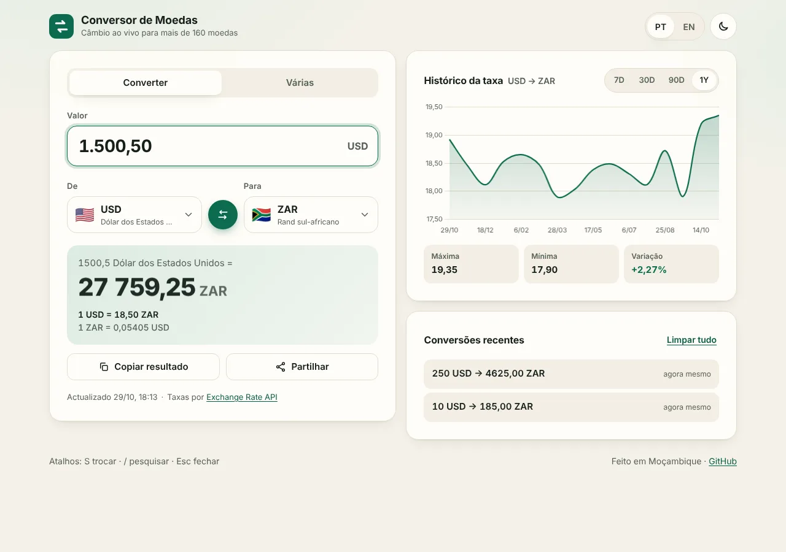
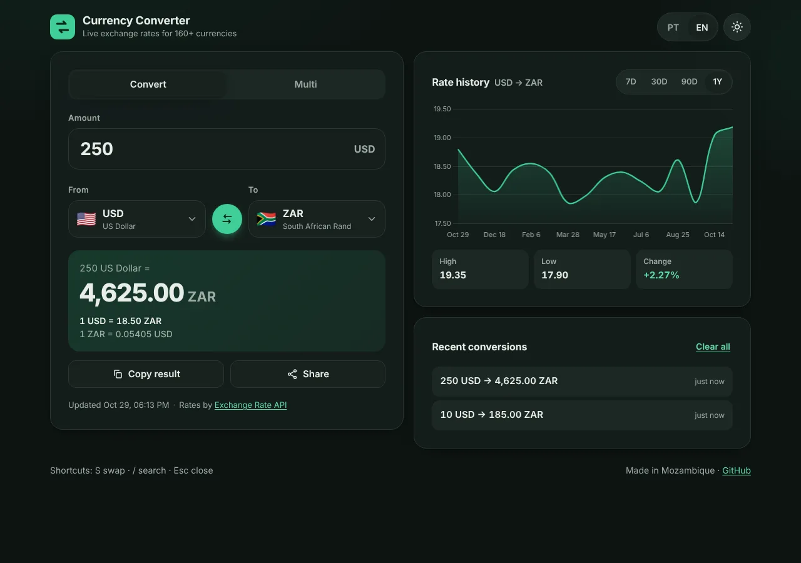
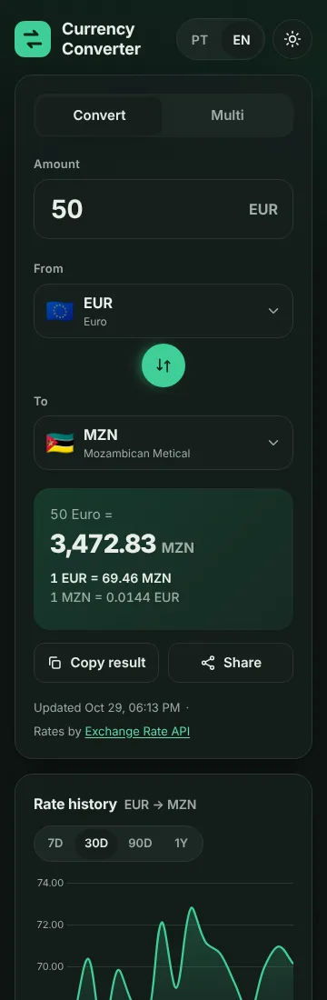
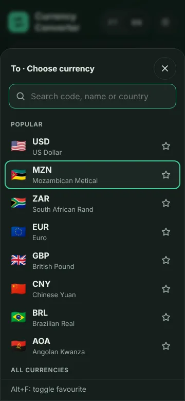

# 💱 Currency Converter

A fast, modern, offline-capable currency converter with live exchange rates for 160+ currencies, including the Mozambican metical (MZN), USD, ZAR and EUR. Bilingual (Português / English), installable as an app, and built with zero frameworks.

**Live demo:** https://ussene47.github.io/currency-converter/



| Dark theme | Mobile | Currency picker |
|---|---|---|
|  |  |  |

<sub>Screenshots were taken with sample rate data.</sub>

---

## Features

**Conversion**
- Live conversion as you type (debounced), with locale-aware number formatting
- Accepts pasted amounts in any common style: `1,500.50`, `1.500,50`, `1 500,50`, `$ 20`, `20 MZN`
- Result, unit rate (`1 USD = 63.90 MZN`) and inverse rate (`1 MZN = 0.01565 USD`)
- Smart precision: 2 decimals normally, up to 8 significant decimals for very small rates
- Swap button with a rotate animation
- **Multi-currency mode**: convert one amount into several currencies at once; add and remove targets

**Currency picker**
- Flags, ISO code and full localised name for every currency
- Search by code, name or country, in Portuguese or English, accent-insensitive (`mocambique` finds MZN)
- Full keyboard support (ARIA combobox + listbox pattern): ↑ ↓, PageUp/PageDown, Enter, Esc
- **Favourites** pinned to the top (★ click or Alt+F), saved on the device

**History and sharing**
- Last 20 conversions, click to reuse, clear all
- Rate history chart for the selected pair: **7D, 30D, 90D, 1Y**, with high, low and change %
- Copy result to clipboard with a toast confirmation
- Share via the Web Share API, falling back to copying the link
- Shareable, bookmarkable URLs: `?from=USD&to=MZN&amount=100`

**Smart defaults**
- Starts at USD → MZN, or suggests your local currency from the browser locale (e.g. `en-ZA` → ZAR)
- Remembers your last pair, amount, chart range, theme and language

**Design and accessibility**
- Mobile-first, soft-card design, responsive from 320 px to wide desktop
- Light and dark themes: follows the system, with a manual toggle that persists
- Skeleton loaders and reserved space, so there is no layout shift while loading
- Semantic HTML, labelled controls, visible focus, WCAG AA contrast in both themes
- Respects `prefers-reduced-motion`
- Keyboard shortcuts: **S** swap · **/** search currencies · **Esc** close

**Offline and performance**
- Installable PWA (Android, desktop) with a service worker caching the app shell and last rates
- Latest rates cached for 1 hour; if the network fails, cached rates are used with a clear "Offline: rates from …" notice
- Friendly messages for invalid input, rate limits, server errors and missing currencies; no raw errors shown
- System fonts and no frameworks: under 100 KB of first-party code before compression; Chart.js loads lazily only when the chart scrolls into view
- Lighthouse (local run): Performance 98 mobile / 100 desktop, Accessibility 100, SEO 100, Best Practices 96

## Tech stack

- HTML5, CSS3 (custom properties, `color-mix`, `<dialog>`), modern JavaScript (ES modules)
- No framework and no build step
- [Chart.js 4](https://www.chartjs.org/) from cdnjs, loaded on demand
- [Vitest](https://vitest.dev/) for unit tests (dev only)
- GitHub Actions + GitHub Pages for CI and hosting

## Run locally

ES modules and the service worker need a web server (opening `index.html` directly from disk won't work).

```bash
git clone https://github.com/ussene47/currency-converter.git
cd currency-converter

# any static server works, for example:
npx serve -l 5173 .
# or
python3 -m http.server 5173
```

Then open http://localhost:5173.

### Tests

```bash
npm install
npm test          # run once
npm run test:watch
```

The tests cover amount parsing (both number styles, ambiguous separators, invalid input), conversion maths, rounding and formatting, rate-history helpers, the cache TTL logic and storage failure handling, and currency search.

## Data sources and attribution

| Data | Provider | Notes |
|---|---|---|
| Latest rates | [Rates By Exchange Rate API](https://www.exchangerate-api.com) — open access endpoint `https://open.er-api.com/v6/latest/USD` | Free, no API key, updated daily. Attribution is shown in the app as the provider requires. |
| Historical rates | [fawazahmed0/exchange-api](https://github.com/fawazahmed0/exchange-api) via jsDelivr, with the `currency-api.pages.dev` fallback | Free, no key, one file per day. Large ranges are sampled (max 16 points) and every point is cached on the device permanently. |

All network code lives in [`js/api.js`](js/api.js), so the provider can be swapped by editing one file.

Rates are for information only and may differ from the rates your bank or a bureau de câmbio offers.

## Project structure

```
currency-converter/
├── index.html            # markup, SEO + Open Graph tags
├── manifest.json         # PWA manifest
├── sw.js                 # service worker (offline shell + cached rates)
├── css/
│   └── styles.css        # design tokens, light/dark themes, layout
├── js/
│   ├── app.js            # state, events, rendering
│   ├── api.js            # all network access + caching
│   ├── ui.js             # currency picker (combobox), toast
│   ├── chart.js          # lazy Chart.js wrapper
│   ├── storage.js        # safe localStorage + TTL cache
│   ├── i18n.js           # Portuguese (pt-MZ) and English strings
│   ├── currencies.js     # currency → country map, flags, search
│   └── utils.js          # parsing, conversion, rounding, formatting
├── assets/               # icons and social preview image
├── tests/                # Vitest unit tests
└── .github/workflows/
    └── deploy.yml        # test, then deploy to GitHub Pages
```

## Deployment

Pushing to `main` runs the tests and deploys to GitHub Pages.

One-time setup: in the repository go to **Settings → Pages → Build and deployment → Source** and choose **GitHub Actions**.

When you change any app file, bump `VERSION` in `sw.js` so returning visitors get the update.

## Contributing

See [CONTRIBUTING.md](CONTRIBUTING.md) for the architecture, data sources and rules for changes.

## Adding a language

Add a new block to `STRINGS` in `js/i18n.js`, register its locale in `LOCALES`, and add a button with `data-lang` in the header. Currency and country names are translated automatically by the browser's `Intl.DisplayNames`.

## License

[MIT](LICENSE) © 2026 Ussene
